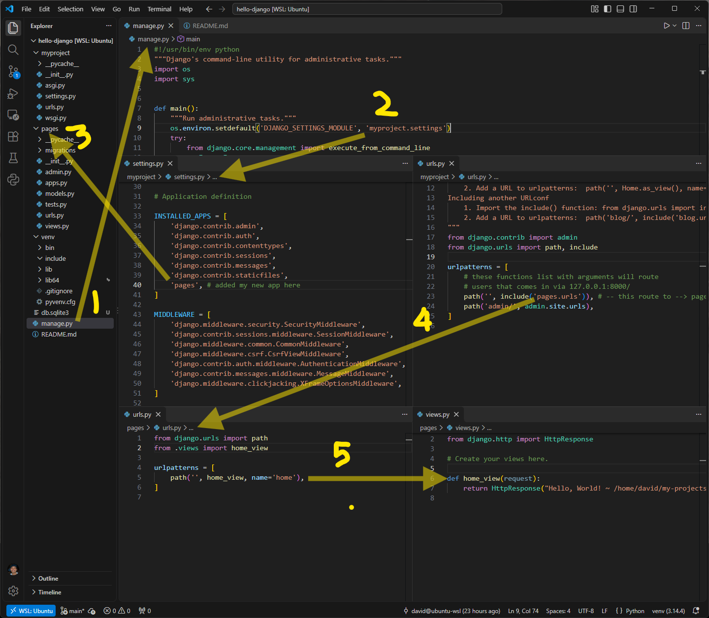

# Hello, World! in Django

To display "Hello, World!" in Django, you need to set up a project, create a view that returns an HTTP response, and map it to a URL. You can ignore or read the following hyperlinks: \
[1] (https://docs.djangoproject.com/en/6.1/intro/tutorial01/), \
[2] (https://learndjango.com/tutorials/django-hello-world) \
The steps below use the standard, modular approach recommended in the Official Django Tutorial.

## 0. Pre-requisite
1. GitHub CLI 
2. Python/Django

### Step 1: Generate an SSH key in WSL
``` bash
ssh-keygen -t ed25519 -C "your@email.com"
```
### Step 2: Copy your public key
``` bash
cat ~/.ssh/id_ed25519.pub
```
Copy the entire ouput starting with ssh-ed25519... 

### Step 3: Add key to GitHub

### Step 4: Switch your remote URL from HTTPS to SSH and push
``` bash
git remote set-url origin git@github.com:daviduntalan/hello-django.git
git push -u origin main
```

## 1. Set Up the Environment and Project

Open your terminal and run the following commands to create a workspace, install Django, and generate your project: \
[1] (https://learndjango.com/tutorials/django-hello-world), \
[2] (https://www.youtube.com/watch?v=76ke335qaIQ)
``` bash
# Create and navigate to a new project folder
mkdir hello-django
cd hello-django

# Create and activate a virtual environment
python -m venv venv
# On Windows use: venv\Scripts\activate
source venv/bin/activate

# Install Django and start a new project
pip install django
django-admin startproject myproject .
``` 

(`Note`: The trailing . creates the project in your current directory instead of making an extra nested folder.) \
[1] (https://learndjango.com/tutorials/django-hello-world)

## 2. Create an App

Django projects are divided into smaller modules called "apps". Create a new app called `pages`: \
[1] (https://www.youtube.com/watch?v=h7rvyDK70FA), \
[2] (https://www.w3schools.com/django/django_create_app.php), \
[3] (https://dev.to/codeitmichael/printing-hello-world-python-django-web-framework-2g89), \
[4] (https://docs.djangoproject.com/en/6.1/intro/tutorial01/)
``` bash
python manage.py startapp pages
``` 
Open `myproject/settings.py` and register your new app inside the `INSTALLED_APPS` list, like the following: \
[1] (https://www.youtube.com/watch?v=s9_ffqanbps), \
[2] (https://www.youtube.com/watch?v=h7rvyDK70FA)
``` python
INSTALLED_APPS = [
    'django.contrib.admin',
    'django.contrib.auth',
    'django.contrib.contenttypes',
    'django.contrib.sessions',
    'django.contrib.messages',
    'django.contrib.staticfiles',
    'pages',  # Add your new app here
]
```

## 3. Create the View

Views handle the logic and determine what content gets sent back to the browser. Open `pages/views.py` and replace its contents with the following: \
[1] (https://www.w3schools.com/django/django_create_app.php), \
[2] (https://learndjango.com/tutorials/django-hello-world), \
[3] (https://docs.djangoproject.com/en/6.1/intro/tutorial01/), \
[4] (https://teclado.com/full-stack-web-development-with-django-5/writing-the-hello-world-app/) 
``` python
from django.shortcuts import render
from django.http import HttpResponse

# Create your views here.

def home_view(request):
    return HttpResponse("Hello, World!")
```

## 4. Configure the URLs

You need to connect your view to a web address. First, create a new file named `urls.py` inside your `pages` folder (`pages/`) and add this code: \
[1] (https://teclado.com/full-stack-web-development-with-django-5/writing-the-hello-world-app/), \
[2] (https://docs.djangoproject.com/en/6.1/intro/tutorial01/)
``` python
from django.urls import path
from .views import home_view

urlpatterns = [
    path('', home_view, name='home'),
]
```
Next, tell the main project about your app's URLs. Open `myproject/urls.py` and update it to include pages.urls: \
[1] (https://www.youtube.com/watch?v=8K52HRoA4Sc), \
[2] (https://teclado.com/full-stack-web-development-with-django-5/writing-the-hello-world-app/) 
``` python
from django.contrib import admin
from django.urls import path, include

urlpatterns = [
    # these functions list with arguments will route 
    # users that comes in via 127.0.0.1:8000/
    path('', include('pages.urls')), # -- this route to --> pages/urls.py
    path('admin/', admin.site.urls),
]
```

## 5. Run the Server

Start the local development server from your terminal: \
[1] (https://www.youtube.com/watch?v=s9_ffqanbps), \
[2] (https://www.youtube.com/watch?v=76ke335qaIQ)
``` bash
python manage.py runserver
```
Open your web browser and go to http://127.0.0.1:8000. You should see "Hello, World!" displayed on the screen.

## Tapos na po!
&copy; 2026 by `David, Jr.`


